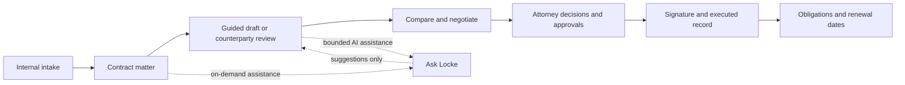

# Locke Professional

### Contract intelligence and lifecycle management, built around the attorney's judgment.

**A matter should not become six disconnected workflows as it moves from request to signature.** Locke Professional brings intake, counterparty review, guided drafting, comparison, approvals, execution, and post-signature obligations into one organization-controlled contract workspace.

**Ask Locke provides context-aware assistance. Attorneys make the decisions.** The platform helps counsel identify issues, understand contractual language, consider negotiating positions, assemble governed documents, and retain the decisions made along the way. It does not practice law or substitute model output for counsel's approval.

[Explore Locke Professional](https://lockeprofessional.com) · [Capabilities](https://lockeprofessional.com/capabilities) · [How it works](https://lockeprofessional.com/how-it-works)

> **Public product and technical reference.** The underlying application, legal content libraries, models, prompts, and customer records remain proprietary. Feature claims below are based on an inspection of the private product's **`release` branch**, application **0.7.1**, Git commit **`89b3f80`** (reviewed October 31, 2026). Live-site availability and every optional provider configuration were **not independently confirmed** during this documentation build.

---

## What Locke Professional delivers

| Challenge for legal teams | Locke Professional capability | Result for the workflow |
|---|---|---|
| Contract requests arrive in email, attachments, and informal messages | **Internal contract intake** linked to a matter | A traceable starting point, not an orphaned request |
| Counterparty language requires careful, repeatable review | **Posture-aware issue review** against firm rules | Findings, source clauses, risk dispositions, and attorney decisions in one record |
| Lawyers need a reliable starting point for drafting | **Governed agreement libraries and guided drafting** | Clause-based assembly, structured decisions, and safeguards for missing terms |
| Negotiation produces competing copies | **Document comparison and redlining** | A visible record of changes and decisions |
| Signature should follow the approved text | **Content-bound approval gates** | A changed draft requires renewed approval under the configured policy |
| An executed agreement creates future duties | **Obligations, terms, and renewal views** | An actionable post-signature contract record |
| The right information is hard to find | **Organization-scoped, full-text repository** | Search contract titles, metadata, and saved document text |
| AI needs professional supervision | **Ask Locke and controlled AI workflows** | Assistance remains distinct from source text, approvals, and legal judgment |

## Ask Locke: assistance at the point of work

Ask Locke is available where a lawyer needs context—in the contract and review workflows. Instead of opening an unrelated chat, counsel can ask about the agreement at hand, explore a provision, understand an issue, or navigate toward an appropriate workspace action.

- **On-matter questions:** ask about termination, indemnities, renewal, payment, or another provision in the current agreement.
- **Candid source limits:** contract chat reports how much agreement text was read when an excerpt, rather than the entire document, was provided to the model.
- **Guided next steps:** assistance can suggest a library/template or destination, with recommendations validated against governed catalog records.
- **Model accountability:** applicable AI operations record provider/model provenance; untrusted contract text is treated as evidence rather than instructions.
- **Counsel owns the outcome:** the model's answer is not the clause of record, a disposition, an approval, or a signature.

[**See Ask Locke capabilities and safeguards**](docs/ASK-LOCKE.md)

## Guided drafting: more than filling blanks

A lawyer can begin with a governed agreement template or describe the business arrangement in a custom-agreement brief. Locke Professional organizes the transaction, identifies issues and risk signals, proposes relevant template starting points, and leads into a maintained clause library for assembly. Undefined terms and structural problems can be flagged for attorney review.

The production-facing library spans **nine agreement collections** covering confidentiality, intellectual property, construction, employment, risk allocation, real estate, services, supply, and software/technology. The exact **publicly advertised template count differs from the owner-reported signed-in workspace count**; current counts are deliberately excluded here until reconciled. [Library coverage](docs/LIBRARY-COVERAGE.md)

[**Explore guided drafting**](docs/GUIDED-DRAFTING.md)

## Review and negotiation: evidence tied to decisions

With a chosen represented-party posture, a lawyer can work through a counterparty contract as a queue of actionable issues. Each issue retains the underlying clause, severity, guidance, comments, and a review decision, with accepted risk separated from a cured or resolved issue. The workspace supports clause review, whole-document context, redlines, and comparisons before a final attorney outcome is recorded.

[**Explore review and negotiation**](docs/REVIEW-NEGOTIATION.md)

## Privacy-minded architecture for confidential legal work

Professional legal work requires more than a promise of privacy. Locke Professional's source-reviewed design contains specific controls:

- **Organization-scoped access:** owner, counsel, and approver roles can work in a shared organization repository; requestors see only contracts they filed.
- **Authentication and session protection:** account sign-in, recovery, multi-factor authentication paths, and session revocation are implemented in the product.
- **Controlled document handling:** original documents and extracted text remain linked to an authorized contract; retrieved source text is rendered as data, not executable HTML.
- **Approval integrity:** approvals can be bound to the content version that counsel reviewed.
- **Executed-document integrity:** signed copies are stored with a cryptographic hash checked again on download.
- **AI boundary disclosure:** on-matter AI assistance can transmit contract excerpts and user questions to a configured model provider. Do not infer local-only AI processing or zero provider retention from the phrase "privacy-minded."

[**Read privacy, security, and AI boundaries**](docs/PRIVACY-AND-SECURITY.md)

## Contract lifecycle, without losing the matter

The same contract record can carry metadata, review history, rules, decisions, approval state, executed artifacts, and follow-up obligations. For dates, the implementation accounts for **weekends but not public holidays**; **automatic reminder delivery is not an implemented feature** in the reviewed release.

[**See contract lifecycle and governance**](docs/CONTRACT-LIFECYCLE.md)

## Representative client scenarios

1. **Vendor-side MSA negotiation:** import a customer's proposed agreement, select the vendor posture, inspect unfavorable provisions, record dispositions, and compare negotiated language.
2. **Firm-controlled NDA drafting:** use a governed confidentiality template, answer structured questions, review surfaced issues, and send the approved version toward execution.
3. **Commercial lease management:** capture renewal and notice terms, search the executed agreement, and surface a computed deadline alongside ongoing obligations.
4. **Multi-person legal team:** receive an internal request, assign review, obtain a different approver when required, and preserve the approved-versus-executed document record.

[**Detailed workflows and expected outcomes**](docs/CLIENT-USE-CASES.md)

## Technical foundation

- Express/Node.js application with PostgreSQL persistence and an organization-aware contract model.
- Governed clause libraries, jurisdiction-aware drafting, validation, and document export.
- Structured review ledger, version comparisons, rules/playbooks, auditable approval and execution transitions.
- OCR for scanned material and native extraction for text-bearing PDF, DOCX, and plain text.
- Server-side multi-format export: **PDF, DOCX, RTF, ODT, HTML, Markdown, and plain text**.
- Capability-aware runtime: some AI, OCR, email, and billing capabilities depend on configured services rather than merely existing code.

[Architecture](docs/TECHNICAL-ARCHITECTURE.md) · [Full capability reference](docs/FEATURE-REFERENCE.md) · [Evidence and release verification](docs/VERIFICATION-AND-STATUS.md)

## Scope and professional responsibility

**Locke Professional supports legal work; it does not act as an attorney or independently guarantee the legal adequacy of an agreement.** First-party typed/drawn signature records are not represented as a qualified independent signing service. External-party public intake, automated deadline reminders, historical analytics time series, and working self-service subscription checkout are **not included as verified functionality** in this release reference. [Precisely documented limits](docs/FEATURE-REFERENCE.md#scope-limits)

**Maintained by Locke Development.** This repository is designed for prospective clients and technical evaluators; it contains **no private application source code**.
