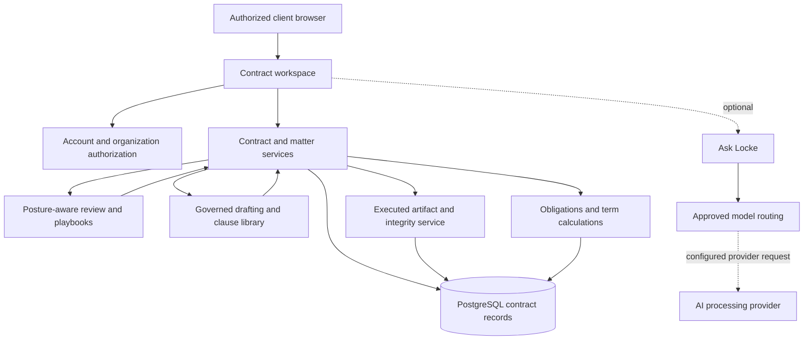

# Technical architecture — public overview

The goal of this reference is to show the engineering decisions behind Locke Professional without disclosing proprietary source code, prompts, implementation secrets, or customer information.

## Deliberate architecture choices

- **One contract ownership model:** contracts belong to organizations, with central visibility rules and distinct requestor access.
- **One drafting authority:** maintained agreement libraries and guarded assembly; model proposals are separate from approved source material.
- **Document-source integrity:** review decisions reference the source clause/version; trusted text is kept separate from counterparties' untrusted uploads.
- **Version-bound approvals:** approval should be about the document that is actually sent for signature, not a status badge.
- **Execution is atomic:** an executed contract has a corresponding stored signed artifact and integrity metadata.
- **Queued post-signature work:** obligation extraction does not block the transaction that records an executed agreement.
- **Defined AI roles:** model routing is controlled by server configuration, and provider/model provenance can accompany generated outputs.
- **Capability-aware application:** the product code distinguishes implemented, configured, degraded, preview, and unavailable states. Some controls appear only when backends exist.

## Stack (source-reviewed)

Node.js/Express, PostgreSQL, maintained legal-content packages, document-processing and OCR components, approved AI service integration, and separate administrative and client UI surfaces. Generated exports include PDF, DOCX, RTF, ODT, HTML, Markdown and text.

The app's public marketing files are deliberately outside this publication package and are not modified.

[Privacy and security](PRIVACY-AND-SECURITY.md) · [Release evidence](VERIFICATION-AND-STATUS.md)
